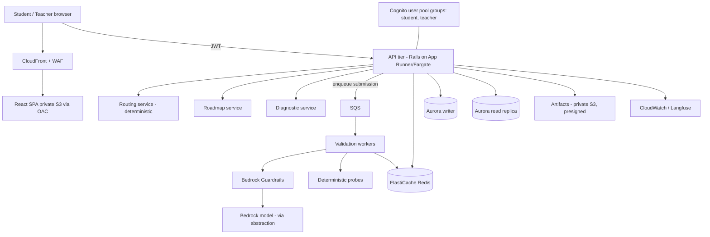
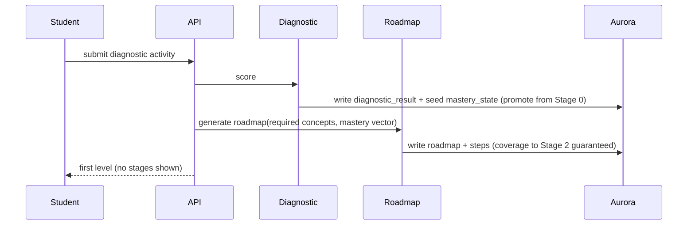
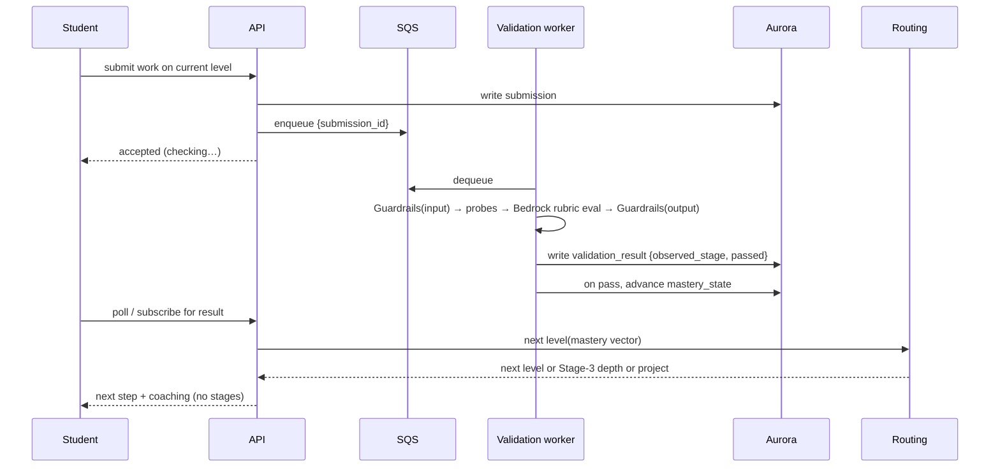

# Technical Design Document — CodeAI Adaptive Learning Engine (MVP)

| Field | Value |
|-------|-------|
| **Document type** | Technical Design Document (implements the BRD) |
| **Status** | Draft for review |
| **Version** | 0.1 |
| **Date** | November 3, 2026 |
| **Author** | Engineering |
| **Implements** | BRD — CodeAI Adaptive Learning Engine (MVP) v0.2 |
| **Companion** | Companion — Adaptive Engine: Stage Model, Validation, and Routing |

---

## 1. Overview

This document describes the technical design for an adaptive learning engine that places a student with a diagnostic, builds a personalized roadmap toward instructor-set CSTA standards, validates each submission into a per-concept mastery stage, and routes the student to the next authored level — with content filtering, a safe fallback, and a teacher-only view of attainment.

The engine is **concept-agnostic**: it operates over whatever concept set, Stage 0–3 rubrics, and level trajectories the instructor configures. The student path uses **human-authored, pre-approved content for anything scored**; AI is used for **validation (rubric eval), coaching, and generating formative (non-scored) practice**, not for free-generating scored curriculum (see §7A). Routing is **deterministic** for auditability.

The design is hosted from a GitHub monorepo onto AWS, deployable in a hackathon-fast configuration and a production-at-scale configuration from the same code.

---

## 2. Design goals and non-goals

### Goals
- Implement the BRD core loop: `diagnostic → roadmap → submit → validate → route → project`, with fallback.
- Make the mastery stage a **backstage signal** enforced server-side (teacher-only).
- Keep the expensive model call off the synchronous student path so the system is scale-ready.
- Keep the model provider swappable behind an abstraction.
- Private-by-default infrastructure; no public S3; least-privilege auth.

### Non-goals (MVP)
- Durable multi-term student profile (longitudinal progress is seeded/simulated).
- Live generation of student-facing content (sandbox-only, gated).
- Full teacher analytics; running the literal 3-month path; catalog-wide scaling.

---

## 3. Constraints (from the BRD / tech environment)

- **Stack:** Rails 7.1 / Ruby 3.2 app tier, React 18 / MUI 7 frontend, Aurora (PostgreSQL-compatible) system of record, Amazon Bedrock, AWS SDK for Ruby. Python permitted. Stack fidelity must not consume build time.
- **Safety/privacy:** filtering on input and output, fail-closed; no student PII in the hackathon environment; no student data shared commercially.
- **Auditability:** routing explainable to a teacher (deterministic, not an agent).
- **Model abstraction:** Bedrock behind a swappable interface.

---

## 3A. Stack conformance (language constraints)

Explicit mapping to the required stack (Ruby 3.2 / Rails 7.1, React 18 / MUI 7 TS, Aurora SQL; Python permitted):

- **Validation and routing live in the Rails app tier.** The adaptive engine extends the existing Rails application at a **single tier**, per the platform rationale. For the MVP they run in-process (or as an in-app background job), not as separate services.
- **Background / validation workers are Ruby** (e.g., ActiveJob / Sidekiq), same codebase as the app. If a worker is extracted at scale (§9), it stays Ruby. Python is used only where Ruby is impractical (e.g., a parsing or eval script).
- **Async SQS + worker fleet is a scale-time evolution, not the MVP shape.** The MVP keeps the submit→validate→route loop inside the single Rails tier; SQS extracts the same Ruby worker later to absorb Hour-of-AI peaks.
- **Aurora engine — open item.** This design assumes Aurora **PostgreSQL** (the §5 schema uses Postgres types). **Confirm against CodeAI production; if it is Aurora MySQL, adjust the schema accordingly.**
- **Infra IaC language is unconstrained** (infra has no opinions); CDK may be authored in TypeScript, Python, or Ruby — prefer Python/Ruby to stay within the three approved languages.

---

## 4. Architecture overview

Browser (student or teacher) → CloudFront → React SPA. Authenticated calls go to the API tier, which fronts the domain services. The only publicly reachable surface is CloudFront; everything else is private.



### Component responsibilities
- **SPA:** renders the student lesson and the teacher dashboard; role determines the home view. Holds no authorization logic of record.
- **API tier:** authenticates the JWT, enforces role + row scoping, orchestrates the services, serializes responses (and strips stage fields for students).
- **Diagnostic service:** scores the placement activity into an initial mastery vector.
- **Validation service:** scores a submission into a per-concept stage using Guardrails + Bedrock rubric eval + deterministic probes. Runs **in the Rails tier** for the MVP (in-process or an in-app Ruby background job); extracted to an async Ruby worker only at scale (§3A, §9).
- **Routing service:** deterministic selection of the next level from the mastery vector.
- **Roadmap service:** generates/regenerates the coverage-guaranteed plan to Stage 2 on every required concept.
- **Fallback/load-shed:** serves the non-adaptive path on error or capacity pressure.

---

## 5. Data model (Aurora — PostgreSQL assumed; confirm engine, §3A)

Curriculum config (authored by T&L), per-class config (set by instructor), and per-student state.

**Curriculum (authored, concept-agnostic engine data):**
- `concept(id, name, csta_standard, order_index)`
- `stage_descriptor(id, concept_id, stage 0..3, sub_skill nullable, descriptor_text)` — the rubric text the validator judges against.
- `level(id, code, student_facing_title, body_ref)` — authored content; titled by what the student makes (no tier words, per FR13).
- `level_transition(level_id, concept_id, from_stage, to_stage)` — many-to-many; one level may advance several concepts.
- `probe(id, concept_id, target_stage, type, spec_json)` — deterministic probe definitions.

**Class config (instructor):**
- `klass(id, teacher_id, name, duration_days, bar_stage default 2)`
- `klass_required_concept(klass_id, concept_id)` — the must-learn set.
- `enrollment(student_id, klass_id)`

**Identity:**
- `app_user(id, cognito_sub, role enum[student,teacher])`

**Per-student state:**
- `mastery_state(student_id, concept_id, current_stage, updated_at)` — the vector.
- `diagnostic_result(student_id, concept_id, placed_stage, created_at)`
- `roadmap(id, student_id, generated_at, status)` + `roadmap_step(roadmap_id, order_index, level_id, target_concepts_json)`
- `submission(id, student_id, level_id, content_ref, created_at)`
- `validation_result(id, submission_id, concept_id, observed_stage, target_stage, passed, evidence_json, probe_results_json, model_meta_json, created_at)`
- `content_artifact(id, student_id, s3_key, created_at)`

**Authoring (author-time; see §7B):**
- `uploaded_source(id, teacher_id, s3_key, extracted_text_ref, pii_scanned, created_at)`
- `authoring_candidate(id, origin enum[ai_draft, upload], source_ref, concept_id, target_stage, scored bool, content_ref, provenance_json, status enum[pending,approved,rejected], reviewer_id, version, created_at)`

**Access invariant:** `mastery_state`, `diagnostic_result`, and `validation_result` are **only ever serialized on teacher-scoped endpoints**. Student responses carry coaching and next-step text, never these rows.

---

## 6. Core flows

### 6.1 Diagnostic → roadmap


### 6.2 Submit → validate → route (async)


This diagram shows the **at-scale** async shape. In the **MVP** this loop runs **in-process in the single Rails tier** (no separate worker, no SQS) — see §3A; the SQS seam is introduced only at scale (§9). Between-level interaction is naturally asynchronous either way, so the student UX is "submit → brief check → next step."

### 6.3 Teacher view
Teacher calls a teacher-scoped endpoint; API verifies `teacher` group and class ownership, reads from the **read replica**, and returns each enrolled student's per-concept stage vs the bar plus diagnostic results.

---

## 7. Validation design

Concept-agnostic. Input: `{submission, concept, target_stage, stage_descriptors, probes}`. Output: `{observed_stage, passed, evidence}`.

Pipeline per submission:
1. **Guardrails on input** (fail-closed; withhold on failure).
2. **Deterministic probes** for the concept/target stage (from `probe.spec_json`). Probes can **cap** the stage: a defining Stage-2 behavior that fails blocks a Stage-2 result regardless of the model.
3. **Bedrock rubric eval** via a single **parameterized prompt**: "Given these Stage descriptors for this concept, which stage does this submission demonstrate, with evidence?" The prompt is identical across concepts; the descriptors are data.
4. **Guardrails on output** before anything derived from it reaches the student.
5. **Cache** keyed by a hash of `{concept, target_stage, normalized_submission}` in ElastiCache to dedupe repeats.

The rubric-eval call goes through the **model abstraction** (Section 10). Results are inspectable in Langfuse (NFR8). Agreement against the human-rated benchmark is the launch gate (BRD M5).

---

## 7A. Content provenance and generation policy

Student-facing content is classified by whether its result **feeds the mastery signal**. That determines provenance.

| Content | Example | Generated? | Rule |
|---|---|---|---|
| **Scored** | Authored levels; any item whose result advances a stage or selects a route | **No (authored)** in MVP | Human-authored, T&L-approved; a wrong item corrupts the routing signal |
| **Formative** | Extra practice, re-explanations, worked examples, coaching/hints | **Yes, allowed** | Bounded to current concept + stage; Guardrails in/out; **excluded from the mastery signal** |
| **Student's own work** | The project artifact the student prompts AI to build | By the student | The learning activity itself |

**Three tiers by stakes (highest-safety first):**
1. **Authored alternates bank** — pre-written approved extras (scored content needing variety).
2. **Parameterized generation** — AI fills an authored template; low variance (formative; scored only with review).
3. **Free generation** — AI writes from scratch (**formative-only in the MVP**; scored free-generation stays in the gated sandbox, FR14).

**Engine rules for generated formative content:**
- Tagged `formative`; never written to `validation_result` / `mastery_state`; it cannot advance a stage or change routing.
- Passes Guardrails on input and output; bounded to the student's current `concept` and `target_stage`.
- The stage is always decided on an **authored checkpoint**; generated practice is unlimited and consequence-free for routing.
- Teacher visibility unaffected (stages still derive only from authored checkpoints).

This makes "a student needs more practice to understand" explicitly supported, while the signal that routes the student stays authored and trustworthy.

---

## 7B. AI-assisted authoring workflow (author-time)

Distinct from runtime generation (§7A), this lane lets AI help *create* content offline behind a human approval gate, so AI-drafted content — **including scored content** — can safely reach students. It also serves the BRD's curriculum-authoring-effort driver.

**Pipeline:**
```
Teacher/T&L: draft with AI   OR   upload source (PDF / slides / doc)
  → S3 (private, KMS)                         [uploads]
  → Amazon Textract extract text (incl. OCR)  [uploads]
  → PII scan / redact
  → Bedrock generates candidates grounded in the draft / extracted text (Guardrails in + out)
  → tag each candidate {concept, target_stage, scored|formative} + provenance link to source passage
  → T&L / teacher review queue: approve / edit / reject
  → approved + versioned → content bank → servable
```

**Governance:**
- **Human approval is mandatory** before any item is servable; that gate is what lets approved items be scored (Tenet 7).
- **Provenance:** every candidate links to its origin (draft prompt or uploaded passage) so a reviewer verifies it against the material rather than trusting the model.
- **PII:** uploaded files are PII-scanned/redacted, KMS-encrypted, and access-scoped to the uploading teacher.
- **Copyright:** generate questions *about* source material; do not republish large verbatim excerpts; suggested external readings are linked with attribution, not copied.
- **Alignment:** a candidate enters the engine only after a reviewer confirms its concept/stage mapping and scored/formative designation.

**New AWS service:** Amazon Textract (document parsing/OCR). Everything else reuses S3, Bedrock, Guardrails, and Aurora.

---

## 8. Routing design (deterministic)

Reads the mastery vector and the class's required-concept list; writes nothing except via the validation worker's stage advancement.

```
target = {each required concept → bar_stage (2)}
below  = required concepts currently < bar_stage
if below empty:
    offer Stage-3 depth on a concept the student chose to extend,
    then route to the project level.
else:
    candidates = authored levels serving a from→to transition for any concept in `below`
    pick the candidate advancing the MOST concepts in `below`
      tie-break: lowest current stage, then instructor concept order
    deliver it.
on validation result:
    passed → advance that concept's stage; recompute
    failed → coaching + AI assistant + alternate level for the same transition;
             after N fails → fallback + flag teacher
INVARIANT: never mark the path complete while any required concept < bar_stage.
```

Deterministic by design (BRD NFR4): the API can always answer "why this level" with the rule and the stage vector. Multi-agent routing is explicitly out (open question in the BRD, not adopted here).

---

## 9. Scale design

**Key property:** because student-facing content is pre-authored, most of what a student loads is **static and CDN-cacheable**. The only expensive dynamic operation is validation. Scale strategy = keep everything on the cache/CDN path and protect the model call behind a queue and a cache.

| Component | MVP | At scale (Hour of AI) |
|---|---|---|
| Edge | CloudFront | CloudFront + WAF + edge rate limiting |
| Authored content | via API | pre-generated, cached at CloudFront, no app-tier hit |
| SPA | Amplify/CloudFront | unchanged |
| Auth | Cognito | scales as-is |
| Routing | in-process | stateless, horizontally autoscaled |
| API | App Runner | ECS Fargate behind ALB, target-tracking autoscaling |
| Validation | in Rails tier (in-process / Ruby job) | extract to async **Ruby** workers behind SQS, rate-limited to model throughput; ElastiCache dedupe; model tiering (probes → cheap model → strong model); Bedrock provisioned throughput pre-bought for the scheduled peak |
| Data | Aurora Serverless v2 | autoscaling ACUs + read replicas for teacher/analytics reads off the write path |
| Safety | Guardrails | scales with Bedrock |

**Fallback as load-shed:** FR10's non-adaptive path triggers not only on error but on **validation queue depth beyond a threshold or Bedrock throttling** — under peak the system degrades to a working non-adaptive lesson rather than failing. One mechanism covers both faults and capacity events.

The MVP demonstrates scale-readiness by building the **seams** (queue, cache, CDN-cached content, depth-triggered fallback), not by generating load.

---

## 10. Model abstraction

A single interface (`ModelClient.evaluate(prompt, params) → structured result`) wraps Bedrock. Validation and coaching depend only on this interface. Swapping models (by grant/credit availability) is configuration: model id, region, throughput mode. No change to validation or routing. Fallback model configured for availability/pricing events (NFR6).

---

## 11. Security design

- **Private by default:** API, Aurora, and Redis in private subnets (prod-shaped); only CloudFront is public. No datastore internet-reachable.
- **No public S3:** both buckets have Block Public Access on. SPA served via CloudFront + OAC; artifacts via short-lived presigned URLs from the authenticated API.
- **AuthN:** Amazon Cognito; JWT carries group (`student`/`teacher`).
- **AuthZ (the backstage guarantee):** API authorizer checks group; data is **row-scoped** (`student_id = token.sub`; teacher limited to owned classes). Stage/score/placement fields are serialized **only** on teacher-scoped endpoints — a student token hitting a stage endpoint gets 403, not a hidden value. This is how BRD Tenet 4 / FR12 / FR13 become enforceable, not cosmetic.
- **Content filtering:** Bedrock Guardrails on input and output, fail-closed (NFR1).
- **Secrets:** Secrets Manager / SSM; never in GitHub. `.env` gitignored.
- **CI → AWS:** GitHub Actions via OIDC-federated IAM role; no long-lived keys.

Exposure-affecting work (endpoints, Cognito/Guardrails wiring, deploy config, bucket policies) follows the builder-security defaults when implemented.

---

## 12. Deployment and repo

Monorepo:
```
codeai-adaptive-engine/
  web/    # React 18 + MUI 7
  api/    # Rails 7.1 services
  infra/  # CDK (TS) — Block Public Access + OAC enforced by default
  docs/   # BRD, companion, this design
  .github/workflows/  # CI + CD (OIDC)
```
- **CI** on PR: lint + test web and api.
- **CD** on merge: web → build → S3 (OAC) → CloudFront invalidate; api → container → ECR → App Runner/Fargate.
- **Two configs from one codebase:** hackathon-fast (Amplify + App Runner + Aurora Serverless) and production-shaped (CloudFront+S3, Fargate+ALB in VPC, read replicas). Infra toggles in CDK, not code forks.

---

## 13. Observability

CloudWatch metrics/alarms (API latency, queue depth, worker throughput, Bedrock throttles, fallback trigger rate) and Langfuse for eval traces to tune validation and support the LLM-as-judge stretch. Queue depth and fallback-trigger rate are the key scale signals.

---

## 14. Failure modes and degradation

| Failure | Behavior |
|---|---|
| Bedrock throttled / slow | queue absorbs; past threshold → fallback (load-shed), flag ops |
| Validation error on a submission | retry; after N → fallback for that concept + flag teacher |
| Repeated student failure on a transition | coaching + AI assistant + alternate level; after N → fallback + flag teacher |
| Guardrails can't filter content | withhold (fail-closed); never deliver unfiltered |
| Model unavailable | switch to configured fallback model |
| Diagnostic mis-placement | first authored level can correct placement (placement is revisable) |

Invariant preserved in all cases: a student never completes the path below Stage 2 on a required concept, and never lands on a broken screen.

---

## 15. Design decisions and trade-offs

- **Deterministic routing over agentic routing** — chosen for auditability (teacher explainability) over flexibility. Agent routing left as an open question.
- **In-tier validation for the MVP, async at scale** — the MVP runs validate→route inside the single Rails tier (platform "single tier" rationale); at Hour-of-AI scale the same **Ruby** validation step is extracted behind SQS for cost/latency control, costing a brief "checking" step in the student UX.
- **Aurora as system of record** — matches production and the relational curriculum/trajectory model; hot reads offloaded to replicas + cache rather than switching stores.
- **Scored content authored, formative content may be generated** — scored items stay authored (and cacheable) so the routing signal is trustworthy; formative practice may be AI-generated, bounded and excluded from the signal (§7A). Free generation of scored content is sandbox-only.
- **Stage data teacher-only, enforced server-side** — chosen so motivation-safety is an access guarantee, not a UI setting.

---

## 16. Design → BRD traceability

| BRD | Design |
|---|---|
| FR1 diagnostic placement | §6.1, Diagnostic service, `diagnostic_result` |
| FR2 roadmap coverage | §6.1, Roadmap service, coverage invariant |
| FR3/FR4 stage validation | §7 Validation (probes + rubric eval, descriptors as data) |
| FR5 routing | §8 deterministic algorithm |
| FR6 Stage 3 optional | §8 branch when `below` empty |
| FR7 authored content | §4/§15 pre-authored, AI routes |
| FR8 AI assistant on failure | §8 fail branch, §14 |
| FR9 project culmination | §8 project route |
| FR10 fallback | §9 load-shed, §14 |
| FR11/NFR1 filtering | §7, §11 Guardrails fail-closed |
| FR12/FR13 backstage, teacher-only | §5 invariant, §11 AuthZ |
| FR15 formative generation | §7A |
| FR16 AI-assisted authoring | §7B |
| FR17 upload-grounded generation | §7B, Textract + §5 authoring tables |
| NFR3 model abstraction | §10 |
| NFR4 auditability | §8 deterministic |
| NFR5 cost/latency | §9 cache/queue/CDN |
| M1–M7 | §6 flows, §7 validation gate, §9 scale, §14 fallback |

---

## Appendix — referenced diagrams
- MVP Architecture (GitHub + AWS, private S3).
- At-Scale Architecture (Hour of AI).
- Companion doc: full Stage 0–3 ladders, trajectory→level maps, probe config, routing pseudocode, visibility boundary, authoring guideline.
